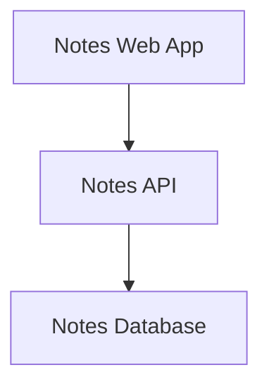
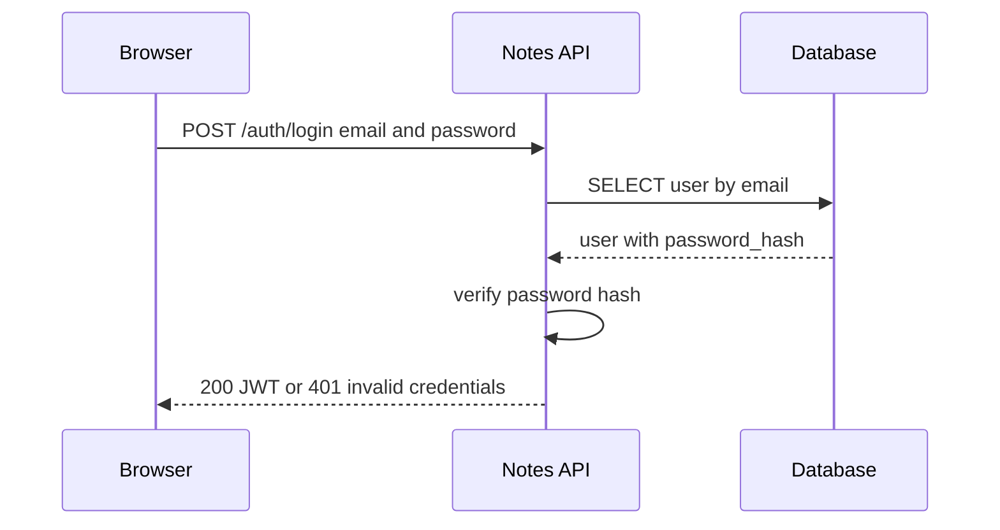
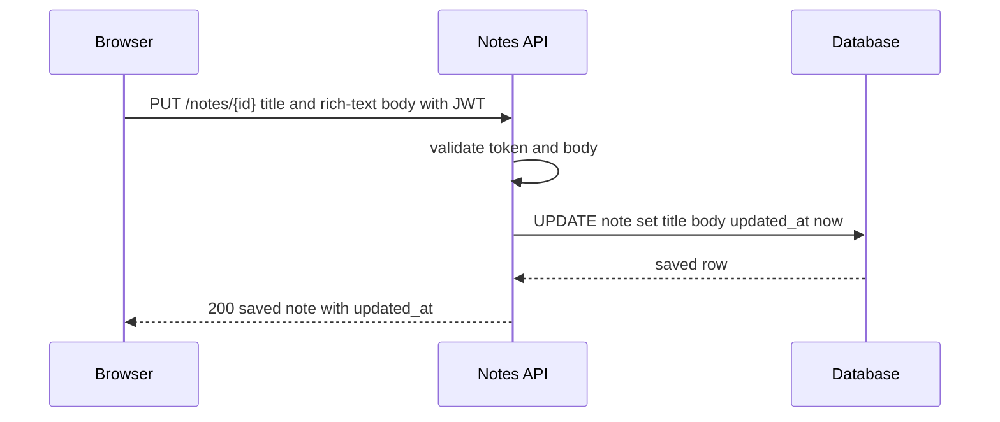
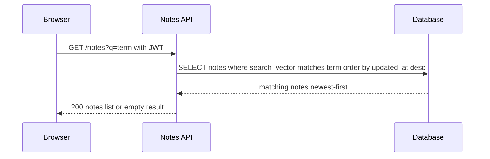
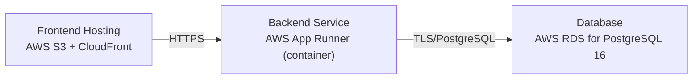

# Architecture

> Maintained by QuorQ AI SDLC. Text between `sdlc:auto` markers is regenerated; anything outside them is yours and is kept.

<!-- sdlc:auto:start narrative -->
## Overview

### ARCH-001 · approved · source: architecture:summary

Overall architecture approved, version 1: a lightweight single-user notes app on React 19 + FastAPI 0.115 + PostgreSQL 16, deployed on AWS.

The approved architecture is a single-user notes application. Frontend: React 19 responsive SPA with a rich-text editor. Backend: FastAPI 0.115 exposing authentication and note CRUD/search endpoints. Database: PostgreSQL 16 storing notes and providing full-text search over title and body. One provisioned account logs in with email and password; every note screen requires a valid session. Deployment target is AWS: static frontend hosting via S3 + CloudFront, a containerised backend, and managed PostgreSQL (RDS) for automatic backups. Explicitly out of scope: sign-up, multi-user support, attachments, external sync.

- ⚠ Requirement keys US-001 through US-013 were provided without descriptions, so this architecture cannot be traced to specific requirements -- traceability matrix cannot be completed until requirement content is supplied.

### ARCH-002 · approved · source: architecture:components:frontend

Frontend component: Notes Web App, a React 19 responsive SPA.

Notes Web App (React 19) serves login, notes list, rich-text editor, view, and search screens. It redirects unauthenticated users to login, filters the notes list as the user types, and triggers auto-save of edits.

### ARCH-003 · approved · source: architecture:components:backend

Backend component: Notes API, a FastAPI 0.115 service.

Notes API (FastAPI 0.115) authenticates the single user, issues and validates session tokens, and serves create/read/update/delete and full-text search of notes. It validates request bodies and enforces that every note endpoint requires a valid login.

### ARCH-004 · approved · source: architecture:components:database

Database component: Notes Database on PostgreSQL 16.

Notes Database (PostgreSQL 16) stores the single user's credentials and notes (title, rich-text body, timestamps), orders notes newest-first by last-updated, and provides built-in full-text search over title and body.

### ARCH-005 · approved · source: architecture:critical_paths:login

Critical path: login and session establishment for the single provisioned owner account.

The owner submits email and password. The backend verifies the password hash against the single provisioned account and returns a JWT on success, or an error that keeps the user on the login page. No self-service sign-up exists.

- ⚠ No detail provided on session/token expiry, refresh, or logout invalidation beyond client-side token discard.

### ARCH-006 · approved · source: architecture:critical_paths:create_autosave

Critical path: creating a note and auto-saving edits.

An authenticated edit is persisted: a new note is created with POST, subsequent auto-saves use PUT. The backend sets the last-updated timestamp on each save, which drives newest-first ordering in the notes list.

- ⚠ Auto-save trigger conditions (e.g. debounce interval, save-on-blur) are not specified in the architecture input.

### ARCH-007 · approved · source: architecture:critical_paths:list_search

Critical path: listing notes newest-first and full-text searching them.

The list is loaded newest-first. As the user types, the frontend queries search, and the backend runs a full-text match over title and body, returning matching notes or an empty set.

### ARCH-008 · approved · source: architecture:entities

Data model: users and notes tables in PostgreSQL 16.

users: id, email, password_hash, created_at. notes: id, user_id, title, body, search_vector, created_at, updated_at. The search_vector column backs the full-text search over title and body; updated_at drives newest-first ordering.

- ⚠ No explicit constraints (e.g. uniqueness on email, foreign key cascade behavior on user_id) are stated.

### ARCH-009 · approved · source: architecture:endpoints

API surface: authentication and note CRUD/search endpoints exposed by the Notes API.

POST /auth/login -- authenticate the single owner with email and password; returns a session token or 401. POST /auth/logout -- ends the current session client-side; token is discarded, stateless confirmation. GET /notes -- list notes newest-first by last-updated; optional q filters by full-text match over title and body. POST /notes -- create a new note with a title and rich-text body. GET /notes/{id} -- retrieve one note with its title and formatted body. PUT /notes/{id} -- update a note's title and/or body (used by auto-save); sets updated_at to now. DELETE /notes/{id} -- permanently delete a note; it leaves the list and search results and cannot be recovered.

- ⚠ No explicit error-handling spec (e.g. responses for not-found, validation failures) beyond the 401 on login.

### ARCH-010 · approved · source: architecture:deployment_nodes

Deployment topology on AWS: static frontend hosting, containerised backend, managed database.

Frontend Hosting: AWS S3 + CloudFront serving the static React 19 build. Backend Service: AWS App Runner running the Python/FastAPI 0.115 container. Database: AWS RDS for PostgreSQL 16.

- ⚠ No networking/security details (VPC, security groups, TLS termination) provided.

### ARCH-011 · approved · source: architecture:technology_decisions

Technology choices and rationale for frontend, backend, database, and cloud.

Frontend: React 19 (alternatives considered: Vue, Svelte) -- chosen to deliver a responsive SPA with rich-text editing and type-ahead search from a single codebase; mature React rich-text editors (TipTap) plug in directly. Backend: FastAPI 0.115 (alternatives: Flask, Django) -- a lean Python framework whose automatic request validation keeps login/note-saving endpoints safe with little code, matching the app's small surface. Database: PostgreSQL 16 (alternatives: SQLite, MySQL) -- stores structured notes reliably, orders them newest-first by timestamp, and provides built-in full-text search so no separate search product is needed. Cloud: AWS (alternatives: Google Cloud, Azure) -- hosts the static frontend on S3/CloudFront and the backend as a container, runs managed PostgreSQL (RDS) with automatic backups, at a low-cost, scale-down footprint.
<!-- sdlc:auto:end narrative -->

<!-- sdlc:auto:start building-blocks -->
## Building Block View

| ID | Name | Technology | Responsibility | Depends on |
|---|---|---|---|---|
| frontend | Notes Web App | React 19 | Responsive SPA serving login, notes list, rich-text editor, view and search. Redirects unauthenticated users to login, filters list as the user types, and triggers auto-save of edits. | backend |
| backend | Notes API | FastAPI 0.115 | Authenticates the single user, issues and validates session tokens, and serves create/read/update/delete and full-text search of notes. Validates request bodies and enforces that every note endpoint requires a valid login. | database |
| database | Notes Database | PostgreSQL 16 | Stores the single user's credentials and notes (title, rich-text body, timestamps), orders notes newest-first by last-updated, and provides built-in full-text search over title and body. | — |

<!-- sdlc:auto:end building-blocks -->

<!-- sdlc:auto:start runtime -->
## Runtime View

### Login and session establishment

The owner submits email and password. The backend verifies the password hash against the single provisioned account and returns a JWT on success, or an error that keeps the user on the login page. No self-service sign-up exists.

- **Components:** frontend, backend, database
- **Modules:** auth.router, auth.service, auth.security, users.repository
- **Key functions:** login(credentials), verify_password(plain, hash), create_access_token(sub), get_user_by_email(email)

### Create or auto-save a note

An authenticated edit is persisted. A new note is created with POST, subsequent auto-saves use PUT. The backend sets the last-updated timestamp on each save, which drives newest-first ordering.

- **Components:** frontend, backend, database
- **Modules:** notes.router, notes.service, notes.repository, auth.dependencies
- **Key functions:** require_auth(token), create_note(payload), update_note(id, payload), touch_updated_at(note)

### List and search notes

The list is loaded newest-first. As the user types, the frontend queries search, and the backend runs a full-text match over title and body, returning matching notes or an empty set.

- **Components:** frontend, backend, database
- **Modules:** notes.router, notes.service, notes.repository
- **Key functions:** list_notes(order_by_updated_desc), search_notes(term), to_tsquery(term)

<!-- sdlc:auto:end runtime -->

<!-- sdlc:auto:start deployment-view -->
## Deployment View

| Name | Service | Runtime | Scaling | Environment |
|---|---|---|---|---|
| Frontend Hosting | AWS S3 + CloudFront | Static React 19 build | CDN edge cache, single-user traffic | dev |
| Backend Service | AWS App Runner (container) | Python / FastAPI 0.115 | Single small instance, scales to minimum for one user | dev |
| Database | AWS RDS for PostgreSQL 16 | PostgreSQL 16 | Single small instance with automated backups | dev |

| Source | Target | Protocol |
|---|---|---|
| Frontend Hosting | Backend Service | HTTPS |
| Backend Service | Database | TLS/PostgreSQL |

<!-- sdlc:auto:end deployment-view -->

<!-- sdlc:auto:start decisions -->
## Architecture Decisions

| Layer | Choice | ADR |
|---|---|---|
| Frontend | React 19 | [ADR-0001](adr/frontend.md) |
| Backend | FastAPI 0.115 | [ADR-0002](adr/backend.md) |
| Database | PostgreSQL 16 | [ADR-0003](adr/database.md) |
| Cloud | AWS | [ADR-0004](adr/cloud.md) |
<!-- sdlc:auto:end decisions -->

<!-- sdlc:auto:start links -->
## Related Documents

- [Data Model](data-model.md)
- [API Specification](api/openapi.yaml)
- [Architecture Decision Records](adr/README.md)
<!-- sdlc:auto:end links -->
