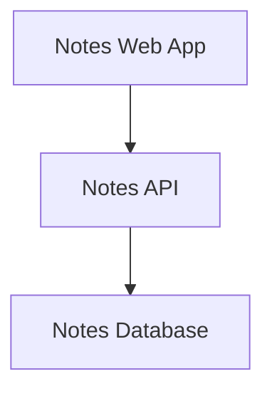
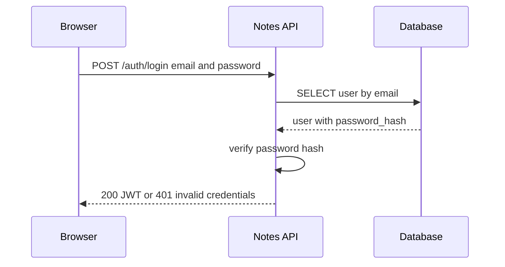
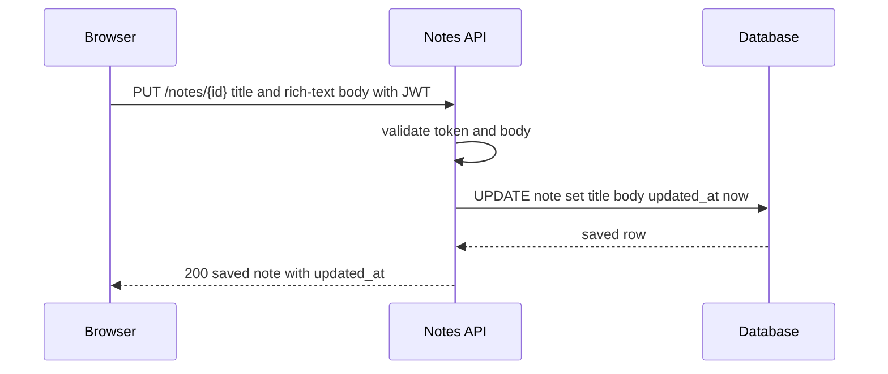
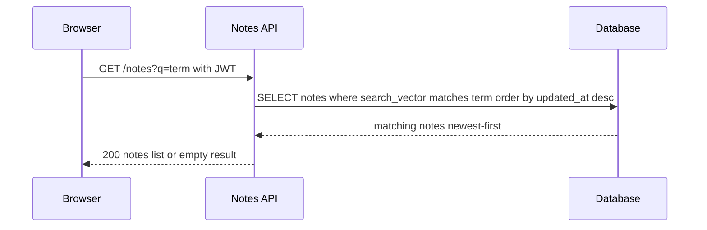
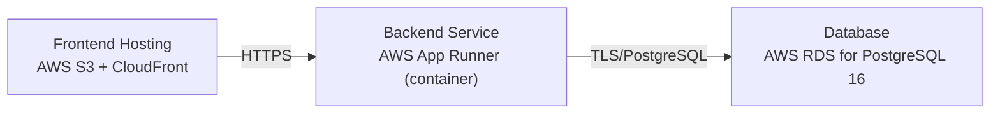

# Architecture

> Maintained by QuorQ AI SDLC. Text between `sdlc:auto` markers is regenerated; anything outside them is yours and is kept.

<!-- sdlc:auto:start narrative -->
## Overview

### ARCH-001 · approved · source: architecture:summary

Approved architecture (v1) for a single-user notes app: React 19 SPA, FastAPI 0.115 backend, PostgreSQL 16 database on AWS, now restyled to a global monochrome (black/white/greyscale) theme.

Status: approved, version 1. The architecture establishes a lightweight single-user notes application: a React 19 responsive SPA with a rich-text editor, a FastAPI 0.115 backend exposing authentication and note CRUD/search endpoints, and a PostgreSQL 16 database with full-text search over title and body. One provisioned account logs in with email/password; every note screen requires a valid session. Deployment is on AWS: static frontend hosting (S3 + CloudFront), a containerised backend, and managed PostgreSQL (RDS) for automatic backups. This revision adds a global black-and-white monochrome theme: shared design tokens move from indigo/purple to black/white/greyscale, applied to login, notes list and search, the note editor and formatting toolbar, note view/edit, and the delete confirmation screen, with contrast verified at desktop and mobile widths. These are presentation-only changes within the existing React frontend; backend, data model, API surface, deployment and runtime needs are unchanged. Explicitly out of scope: sign-up, multi-user, attachments, external sync.

**Related:** US-015, US-016, US-017, US-018

- ⚠ Input explicitly ties the monochrome restyle to US-015, US-016, US-017, US-018 only; requirement keys US-001-US-014, US-019, US-020 are not mapped to any specific architecture element in this input -- confirm whether they apply to this phase or were covered elsewhere.
- ⚠ No delete confirmation screen details given beyond 'restyled to monochrome' -- no critical path or endpoint narrative describes its UX flow.

### ARCH-002 · approved · source: architecture:components:frontend

Frontend component: Notes Web App built in React 19 as a responsive single-page application.

Serves login, notes list, rich-text editor, view and search screens. Redirects unauthenticated users to login. Filters the notes list as the user types (type-ahead search). Triggers auto-save of edits. Applies a global black-and-white monochrome theme from shared design tokens across every screen, with contrast verified at desktop and mobile widths.

**Related:** US-015, US-016, US-017, US-018

### ARCH-003 · approved · source: architecture:components:backend

Backend component: Notes API built with FastAPI 0.115.

Authenticates the single user, issues and validates session tokens, and serves create/read/update/delete and full-text search of notes. Validates request bodies and enforces that every note endpoint requires a valid login.

- ⚠ No requirement key is explicitly linked to this component in the input.

### ARCH-004 · approved · source: architecture:components:database

Database component: Notes Database on PostgreSQL 16.

Stores the single user's credentials and notes (title, rich-text body, timestamps). Orders notes newest-first by last-updated. Provides built-in full-text search over title and body.

- ⚠ No requirement key is explicitly linked to this component in the input.

### ARCH-005 · approved · source: architecture:critical_paths:login_and_session_establishment

Critical path for login and session establishment using the single provisioned account.

The owner submits email and password. The backend verifies the password hash against the single provisioned account and returns a JWT on success, or an error that keeps the user on the login page. No self-service sign-up exists. The login page and its error message render using the shared monochrome theme.

**Related:** US-015

### ARCH-006 · approved · source: architecture:critical_paths:create_or_autosave_a_note

Critical path for creating a note and auto-saving edits.

An authenticated edit is persisted: a new note is created with POST, subsequent auto-saves use PUT. The backend sets the last-updated timestamp on each save, which drives newest-first ordering. The editor, formatting toolbar and view/edit screens render in the monochrome theme.

**Related:** US-017, US-018

### ARCH-007 · approved · source: architecture:critical_paths:list_and_search_notes

Critical path for listing notes newest-first and searching them.

The list is loaded newest-first. As the user types, the frontend queries search, and the backend runs a full-text match over title and body, returning matching notes or an empty set. The list rows, highlights, search box and empty-result indication render in the monochrome theme.

**Related:** US-016

### ARCH-008 · approved · source: architecture:entities

Data model: two entities, users and notes.

users: id, email, password_hash, created_at. notes: id, user_id, title, body, search_vector, created_at, updated_at. The search_vector field backs PostgreSQL full-text search over title and body; updated_at drives newest-first list ordering.

- ⚠ No requirement keys explicitly linked to the data model in the input.

### ARCH-009 · approved · source: architecture:endpoints

API surface: authentication and note CRUD/search endpoints.

POST /auth/login - authenticate the single owner with email and password; returns a session token or 401. POST /auth/logout - end the current session client-side; token is discarded, stateless confirmation. GET /notes - list notes newest-first by last-updated; optional q filters by full-text match over title and body. POST /notes - create a new note with a title and rich-text body. GET /notes/{id} - retrieve one note with its title and formatted body. PUT /notes/{id} - update a note's title and/or body (used by auto-save); sets updated_at to now. DELETE /notes/{id} - permanently delete a note; it leaves the list and search results and cannot be recovered.

**Related:** US-015, US-016, US-017, US-018

### ARCH-010 · approved · source: architecture:deployment_nodes

Deployment topology on AWS: static frontend hosting, containerised backend, managed database.

Frontend Hosting: AWS S3 + CloudFront serving the static React 19 build. Backend Service: AWS App Runner running the containerised Python/FastAPI 0.115 app. Database: AWS RDS for PostgreSQL 16, providing automatic backups.

### ARCH-011 · approved · source: architecture:technology_decisions

Technology stack decisions and rationale for frontend, backend, database, and cloud.

Frontend: React 19 (alternatives considered: Vue, Svelte) -- delivers a responsive SPA with rich-text editor and type-ahead search from a single codebase; mature React rich-text editors (TipTap) plug in directly; the monochrome restyle is a single-source change via shared CSS/theme tokens. Backend: FastAPI 0.115 (alternatives: Flask, Django) -- lean Python framework with automatic request validation, keeping login and note-saving endpoints safe with little code for this small, well-defined surface. Database: PostgreSQL 16 (alternatives: SQLite, MySQL) -- stores structured notes reliably, orders by timestamp, and provides built-in full-text search so no separate search product is needed. Cloud: AWS (alternatives: Google Cloud, Azure) -- makes the app reachable from any browser, hosts static frontend on S3/CloudFront and backend as a container, runs managed PostgreSQL (RDS) with automatic backups at a low-cost, scale-down footprint.
<!-- sdlc:auto:end narrative -->

<!-- sdlc:auto:start building-blocks -->
## Building Block View

| ID | Name | Technology | Responsibility | Depends on |
|---|---|---|---|---|
| frontend | Notes Web App | React 19 | Responsive SPA serving login, notes list, rich-text editor, view and search. Redirects unauthenticated users to login, filters list as the user types, and triggers auto-save of edits. Applies a global black-and-white (monochrome) theme from shared design tokens across every screen, with contrast verified at desktop and mobile widths. | backend |
| backend | Notes API | FastAPI 0.115 | Authenticates the single user, issues and validates session tokens, and serves create/read/update/delete and full-text search of notes. Validates request bodies and enforces that every note endpoint requires a valid login. | database |
| database | Notes Database | PostgreSQL 16 | Stores the single user's credentials and notes (title, rich-text body, timestamps), orders notes newest-first by last-updated, and provides built-in full-text search over title and body. | — |

<!-- sdlc:auto:end building-blocks -->

<!-- sdlc:auto:start runtime -->
## Runtime View

### Login and session establishment

The owner submits email and password. The backend verifies the password hash against the single provisioned account and returns a JWT on success, or an error that keeps the user on the login page. No self-service sign-up exists. The login page and its error message render using the shared monochrome theme (US-015).

- **Components:** frontend, backend, database
- **Modules:** auth.router, auth.service, auth.security, users.repository
- **Key functions:** login(credentials), verify_password(plain, hash), create_access_token(sub), get_user_by_email(email)

### Create or auto-save a note

An authenticated edit is persisted. A new note is created with POST, subsequent auto-saves use PUT. The backend sets the last-updated timestamp on each save, which drives newest-first ordering. The editor, formatting toolbar and view/edit screens render in the monochrome theme (US-017, US-018).

- **Components:** frontend, backend, database
- **Modules:** notes.router, notes.service, notes.repository, auth.dependencies
- **Key functions:** require_auth(token), create_note(payload), update_note(id, payload), touch_updated_at(note)

### List and search notes

The list is loaded newest-first. As the user types, the frontend queries search, and the backend runs a full-text match over title and body, returning matching notes or an empty set. The list rows, highlights, search box and empty-result indication render in the monochrome theme (US-016).

- **Components:** frontend, backend, database
- **Modules:** notes.router, notes.service, notes.repository
- **Key functions:** list_notes(order_by_updated_desc), search_notes(term), to_tsquery(term)

<!-- sdlc:auto:end runtime -->

<!-- sdlc:auto:start deployment-view -->
## Deployment View

| Name | Service | Runtime | Scaling | Environment |
|---|---|---|---|---|
| Frontend Hosting | AWS S3 + CloudFront | Static React 19 build | CDN edge cache, single-user traffic | dev |
| Backend Service | AWS App Runner (container) | Python / FastAPI 0.115 | Single small instance, scales to minimum for one user | dev |
| Database | AWS RDS for PostgreSQL 16 | PostgreSQL 16 | Single small instance with automated backups | dev |

| Source | Target | Protocol |
|---|---|---|
| Frontend Hosting | Backend Service | HTTPS |
| Backend Service | Database | TLS/PostgreSQL |

<!-- sdlc:auto:end deployment-view -->

<!-- sdlc:auto:start decisions -->
## Architecture Decisions

| Layer | Choice | ADR |
|---|---|---|
| Frontend | React 19 | [ADR-0001](adr/frontend.md) |
| Backend | FastAPI 0.115 | [ADR-0002](adr/backend.md) |
| Database | PostgreSQL 16 | [ADR-0003](adr/database.md) |
| Cloud | AWS | [ADR-0004](adr/cloud.md) |
<!-- sdlc:auto:end decisions -->

<!-- sdlc:auto:start links -->
## Related Documents

- [Data Model](data-model.md)
- [API Specification](api/openapi.yaml)
- [Architecture Decision Records](adr/README.md)
<!-- sdlc:auto:end links -->
